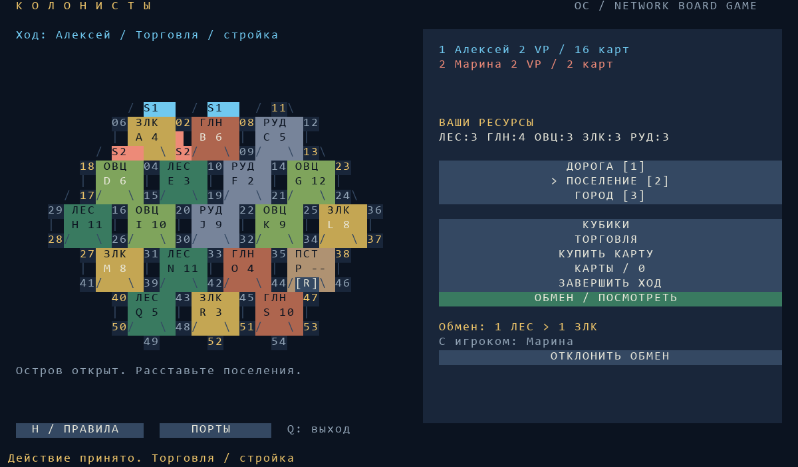

# Колонисты — сетевая настольная игра для OpenComputers

Неофициальная самостоятельная реализация по мотивам «Колонизаторов» / CATAN.
Поле, рисунки и интерфейс создаются программой; материалы из коробки не требуются.
Одна и та же версия `colonists.lua` должна стоять на всех компьютерах.



## Оборудование и установка

Для каждого из 2–4 игроков:

- Компьютер с OpenOS, клавиатурой, монитором и видеокартой уровня 2 или 3.
- Минимальное разрешение — 80×25. На уровне 3 используется до 100×32:
  панель показывает журнал, бонусы, остаток построек и условия обмена.
- Сетевая карта **modem**, обычная или беспроводная. Интернет-карта не подходит.
- Рекомендуется не менее 2 МиБ оперативной памяти для OpenOS и игры.

Соедините обычные карты кабелем OpenComputers. Для беспроводной игры компьютеры
должны находиться в пределах дальности установленных карт; программа временно
задаёт мощность 400, а модем ограничивает её своими возможностями. Оба компьютера
должны быть включены и загружены в мире. Интернет не нужен.

Скопируйте `colonists.lua` в `/home` на каждом компьютере. На компьютере ведущего:

```sh
cd /home
colonists host Алексей
```

На остальных:

```sh
colonists join Марина
```

Игрок выбирает комнату на экране. Когда все подключились, ведущий нажимает
«Начать». Сам ведущий тоже играет, занимая первое место. Без аргументов
`colonists` открывает меню создания и поиска комнаты.

Можно указать полный адрес модема ведущего третьим аргументом:

```sh
colonists join Марина 12345678-1234-1234-1234-123456789abc
```

Адрес показывается в комнате ожидания. Прямой выбор адреса по-прежнему требует
достижимости ведущего через модем: это не соединение через Интернет.

## Поле и управление

Игра управляется нажатием на монитор. На узлах стоят номера **01–54**,
на гексах — буквы **A–S**, тип местности и число добычи. Золотые номера на берегу
обозначают доступ к порту; кнопка «Порты» показывает их условия.

- **S1** — поселение игрока 1, **C1** — его город. Цвет совпадает с игроком в списке.
- Выберите «Дорога» и нажмите на ребро между двумя узлами.
- Выберите «Поселение» и нажмите на свободный узел.
- Выберите «Город» и нажмите на своё поселение.
- Допустимые узлы и рёбра подсвечиваются золотым для выбранного инструмента.
  Подсветка проверяет расположение, а ресурсы и лимиты проверяются при строительстве.
- **1 / 2 / 3** выбирают дорогу, поселение или город.
- **H** открывает справку, **Esc** закрывает окно, **Q / Ctrl+C** завершает программу.
  Латинские клавиши работают и при русской раскладке.

Названия ресурсов в компактной панели: Л — лес, Г — глина, Ш — шерсть,
З — зерно, Р — руда. В поле используются ЛЕС, ГЛН, ОВЦ, ЗЛК, РУД.

## Ход игры

В начале каждый бесплатно ставит два поселения и две дороги. Сначала игроки
ходят от первого к последнему, затем от последнего к первому. Дорога должна
примыкать к только что поставленному поселению. Ресурсы выдаются за второй
стартовый узел. Между любыми двумя поселениями должен оставаться свободный узел.

После расстановки игрок бросает два кубика. Гексы с выпавшим числом дают ресурсы
всем соседним поселениям и городам. Разбойник блокирует добычу своего гекса.
При семёрке игроки с более чем семью ресурсами сами выбирают половину карт
для сброса с округлением вниз. Нажмите «Сбросить … карт» и выберите карты кнопками
плюс/минус. Затем игрок хода перемещает разбойника нажатием на другой гекс
и крадёт случайный ресурс у одного из соседних соперников.

Далее можно строить, торговать и покупать карты, затем нажать «Завершить ход».
Постройки требуют ресурсов; справка H показывает стоимость. Максимум на игрока:
15 дорог, 5 поселений и 4 города. Новые дороги должны продолжать свою сеть;
поселение соперника блокирует проход через узел.

Кнопка «Торговля» позволяет выбрать отдаваемый и получаемый ресурс. Банк
обменивает 4:1, общий порт — 3:1, специальный порт — 2:1 соответствующего
ресурса. Для обмена с игроком выберите количество каждой стороны и адресата.
Адресат нажимает «Обмен / посмотреть», изучает условия и принимает либо
отклоняет предложение. Обмен выполняется только после согласия, если карты
по-прежнему есть у обеих сторон. Переключение количества идёт от 1 до 19 по кругу.

В колоде есть рыцари, победные очки, две дороги, монополия и изобилие.
Купленная карта действия недоступна до следующего своего хода; можно сыграть
только одну такую карту за ход. Окно «Карты» позволяет выбрать ресурс для
монополии или два ресурса для изобилия. Рыцарь доступен и до броска кубиков.
Карта дорог даёт до двух бесплатных дорог, которые ставятся обычным инструментом
после броска. Неиспользованные бесплатные дороги сгорают при завершении хода.

Поселение даёт 1 очко, город — 2. За непрерывную дорогу длиной от 5 и армию
от 3 сыгранных рыцарей выдаётся по 2 очка. При равенстве лидер сохраняет бонус,
если всё ещё соответствует максимуму. Побеждает игрок, набравший 10 очков
в свой ход, включая скрытые карты победных очков.

За основу взяты [правила базовой CATAN](https://www.catan.com/understand-catan/game-rules).
Это адаптация: для двух игроков используется то же поле без дополнительных
нейтральных фигур; порты расставлены программой; бесплатные дороги можно
не достраивать; нет дополнений, ботов и отдельной анимации бросков. Для партии,
близкой к настольной базе, играйте втроём или вчетвером.

## Связь и ограничения

Ведущий проверяет очередность, стоимость, расстояния, коллизии, торговлю и
случайные события. Клиенты отправляют запросы действий. Личные ресурсы и карты
других игроков в их сетевых снимках скрыты. Это приватность между обычными
клиентами, без шифрования от администратора ведущего компьютера или перехвата
пакетов игровыми средствами.

Используется порт **24680**, протокол `COLONISTS/1`, фрагменты до 1800 байт.
Большое состояние разбивается на пакеты; неполные сообщения удаляются после
5 секунд. Есть подтверждения запросов, повторы и защита от двойного выполнения.
Состояние дополнительно сверяется каждые 3 секунды. Подробнее о сетевой карте —
в [документации OpenComputers](https://ocdoc.cil.li/component:modem).

При временной потере связи партия ждёт игрока. После перезапуска клиентской
программы можно снова выбрать прежнюю комнату: место определяется адресом
сетевой карты, а карты и постройки сохраняются у ведущего. Новые игроки после
начала не принимаются. Адрес модема должен оставаться прежним.

**Партия хранится в памяти ведущего.** Сохранения на диск и миграции ведущего
нет: выход или перезапуск ведущего завершит текущую партию. При выходе программа
восстанавливает разрешение, палитру, глубину цвета, курсор и мощность модема;
порт закрывается только если его открыла сама игра.

## Проверка

```sh
python tests/test_colonists.py
```

Нужны Python, `lupa` и Pillow для PNG-превью. Проверки запускают Lua 5.2 и 5.3:
геометрия, расстановка 2–4 игроков, производство, сохранение количества ресурсов,
сброс, кража, обмен, порты, карты, бонусы, победа, закрытые руки, ведущий,
повторы запросов, устаревшие ходы, сборка фрагментов и интерфейс 80×25/100×32.
Превью строится из вывода имитируемой видеокарты. Проверки не заменяют испытания
на двух настоящих компьютерах Minecraft с задержками и настройками сервера.
