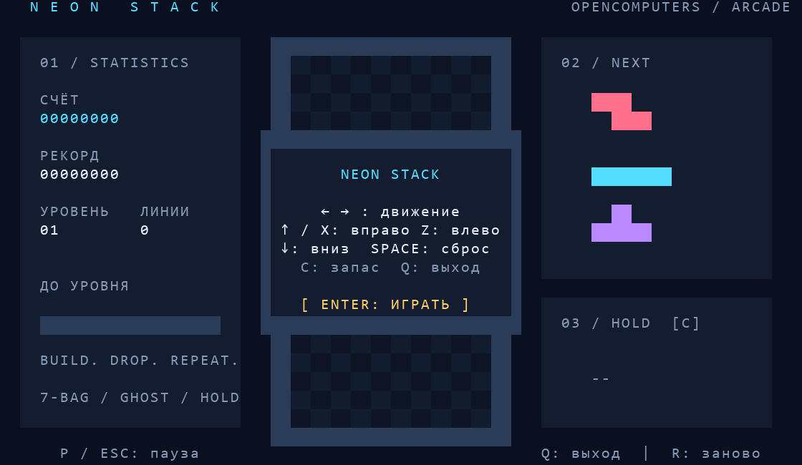

# NEON STACK — тетрис для OpenComputers

Скопируйте `tetris.lua` в `/home` компьютера с OpenOS. Запуск:

```sh
cd /home
tetris
```

Нужны подключённые клавиатура, монитор и видеокарта второго уровня или выше,
поддерживающие 80×25. Интернет, дополнительные библиотеки и компоненты не нужны.
Игра временно задаёт разрешение 80×25 и свою цветовую палитру. При выходе,
Ctrl+C или ошибке восстанавливает разрешение, палитру, глубину цвета и курсор.



## Управление

| Клавиша | Действие |
|---|---|
| Enter | Начать, продолжить после паузы, сыграть снова |
| ← / A, → / D | Двигать фигуру |
| ↑ / W / X | Поворот по часовой стрелке |
| Z | Поворот против часовой стрелки |
| ↓ / S | Опустить на одну клетку |
| Пробел | Мгновенно сбросить фигуру |
| C | Убрать фигуру в запас или обменять с запасной |
| P / Esc | Пауза |
| R | Начать заново, в том числе на паузе |
| Q / Ctrl+C | Выйти |

Клавиши определяются по физическим кодам: русская раскладка тоже подходит.

## Правила

Поле 10×20, семь типов фигур. Каждая перемешанная семёрка содержит по одной
фигуре каждого типа. Справа показаны три следующие фигуры и запас; обменивать
запасную фигуру можно один раз до установки текущей. Контур показывает место
падения. После касания пола есть 0,4 секунды для поправки; движение и поворот
могут продлить задержку до 15 раз. Поворот у стены пробует горизонтальные
смещения; это упрощённая система, без полного набора правил SRS и T-spin.

За 1/2/3/4 линии начисляется 100/300/500/800 очков, умноженных на текущий уровень.
Мягкое падение даёт 1 очко за клетку, мгновенное — 2. Каждые 10 линий увеличивается
уровень и скорость. Заполнение зоны появления или установка фигуры выше поля
завершает игру.

Рекорд записывается в `/home/tetris-best.txt` при завершении игры и выходе.
Если файл недоступен для записи, игра продолжает работать, но рекорд не сохранится.
Путь можно изменить в переменной `bestPath`.

## Проверка без Minecraft

`python tests/test_tetris.py` (Python, `lupa` и Pillow).
Проверяются правила в Lua 5.2 и 5.3, очистка четырёх линий, счёт, уровни,
коллизии, запас, конец игры, границы экрана, клавиатура и восстановление
терминала после ошибки. Превью строится по выводу имитируемой видеокарты;
реальный шрифт и цвета могут немного отличаться в Minecraft.
